## operaciones basicas con opencv
## Alumno Samuel Martinez NC 0096
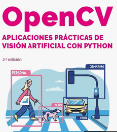
## 1. LECTURA DE LA IMAGEN DESDE CARPETA
## Cuando no puede leer la imagen
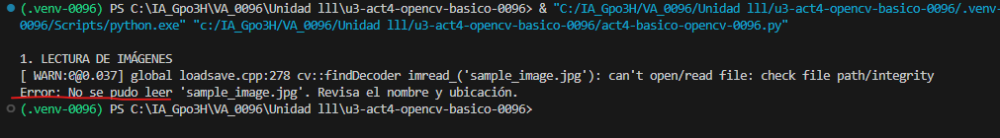
## Cuando puede leer la imagen
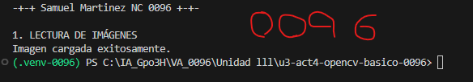
## 2. PROPIEDADES DE LA IMAGEN
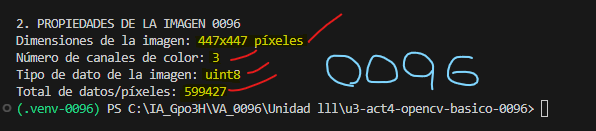
## Mostrando imagen original 

## EN LA TERMINAL
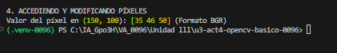
## 4. ACCESO Y MODIFICACIÓN DE PÍXELES INDIVIDUALES
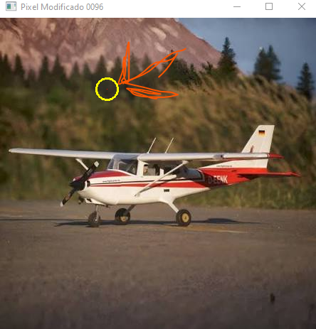
## 5. REGIÓN DE INTERÉS (ROI - REGION OF INTEREST)
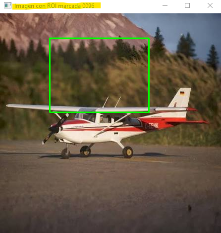
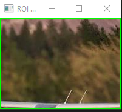
## 6. SEPARACIÓN Y FUSIÓN DE CANALES DE COLOR (BGR)
## ESCALA DE GRISES
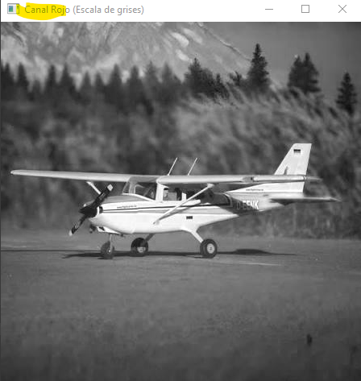

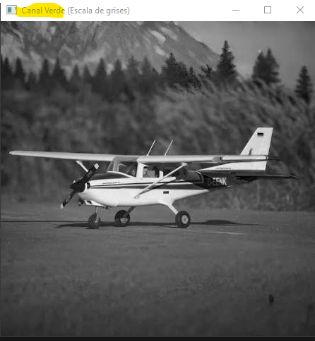
## COLOREADOS
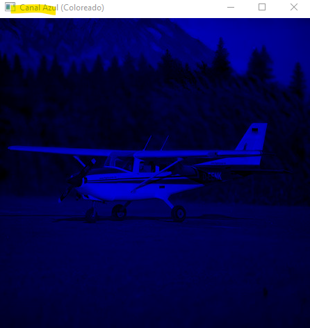
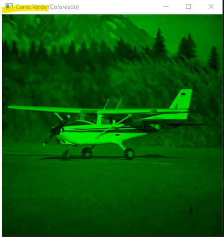
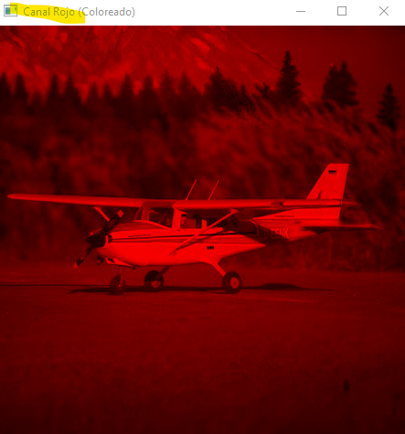
## 7. REDIMENSIONAMIENTO DE IMÁGENES (RESIZING)
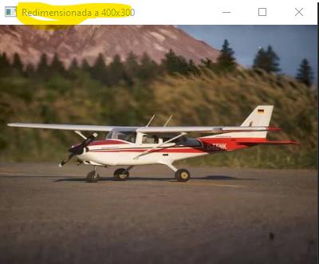
## Mitad de tamaño
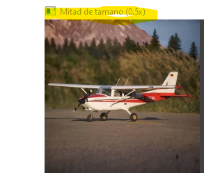
## Ampliada

## 8. ROTACIÓN DE IMÁGENES
## 45 grados

## 9. VOLTEO / ESPEJO DE IMÁGENES (FLIPPING)
## Volteo Horizontal (Espejo)

## Volteo Vertical (De cabeza)

## Volteo en Ambos Ejes
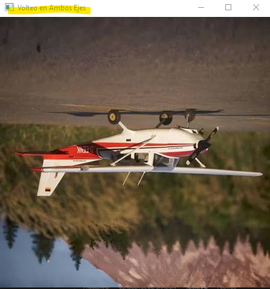